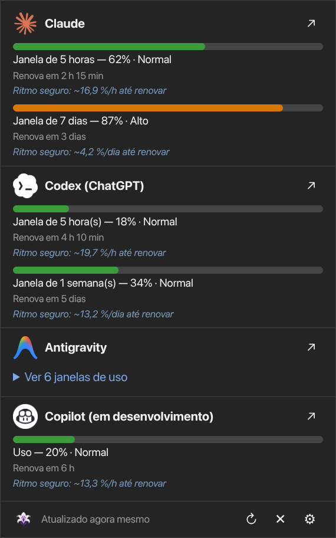
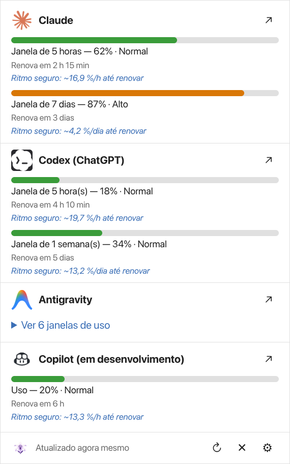
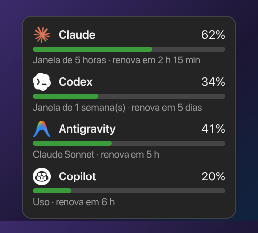
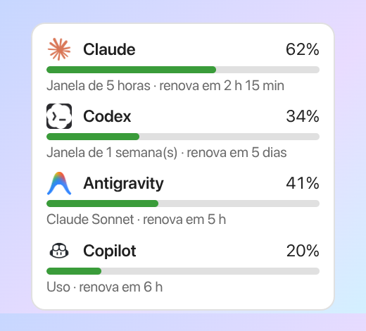
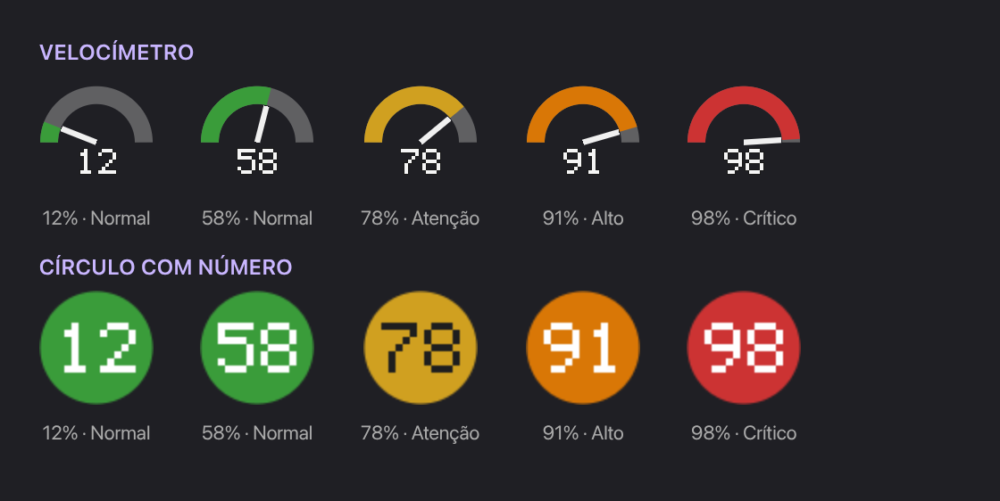
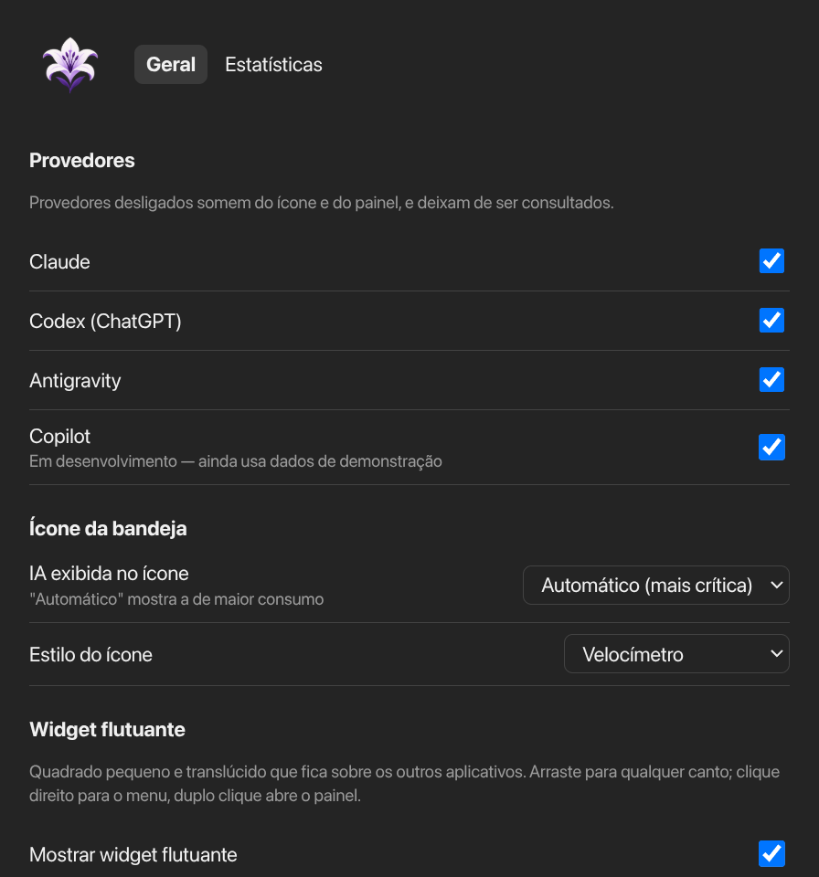
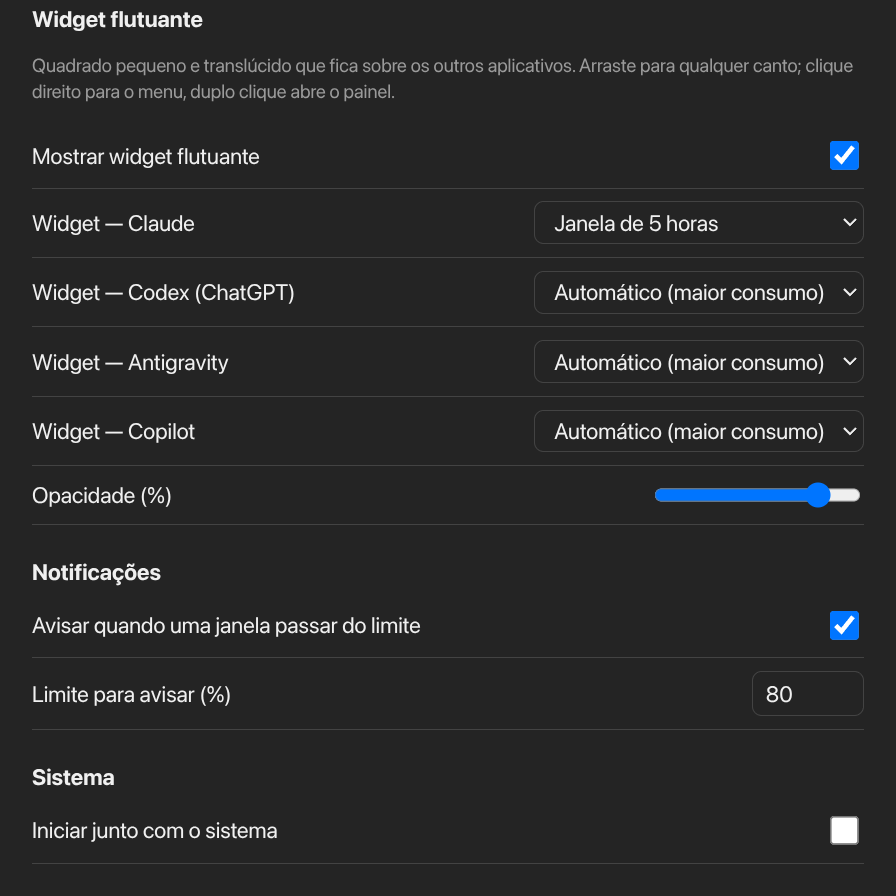
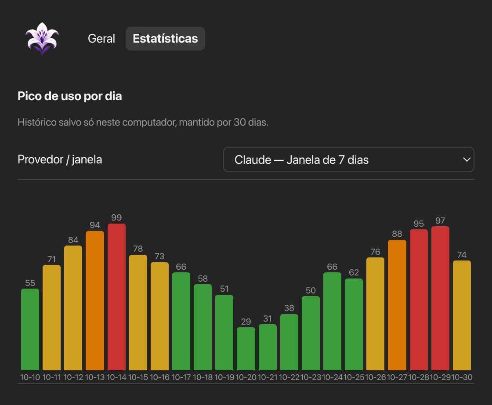
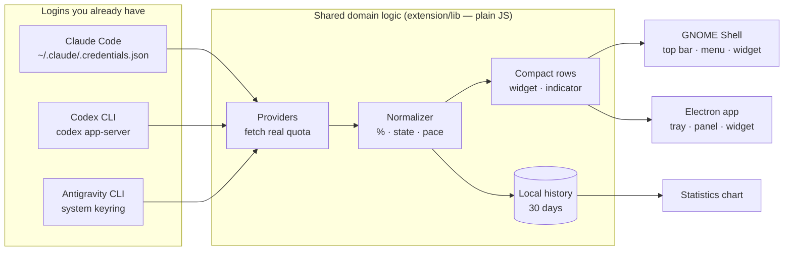

<div align="center">



<br>

[](#gnome-extension)
[](#windows)
[](#linux-without-gnome-kde-xfce-)
[](desktop/README.md)


**Claude · Codex (ChatGPT) · Antigravity (Gemini) · Copilot** — one indicator instead of four apps.

[Features](#-features) · [Screenshots](#-screenshots) · [Install](#-installation) · [How it works](#-how-it-works) · [Privacy](#-privacy--security) · [Development](#-development)

</div>

---

> [!NOTE]
> Monitors **usage/quota**, never money spent. The UI (popup, preferences, notifications)
> is in Portuguese (pt-BR) for now — that's why the screenshots show Portuguese text.

## ✨ Why this exists

If you juggle more than one AI subscription day to day, it's easy to get blindsided by a limit
hitting mid-task. **AI Usage Monitor** puts all of them in one place: glance at the top bar (or a
little floating card) to see how much is left on each — and **when it renews**.

## 🚀 Features

<table>
<tr>
<td width="33%" valign="top">

### 📊 Real quota
Actual percentages from your account for **Claude**, **Codex** and **Antigravity**, reusing the login
the official CLIs already made. Not an estimate.

</td>
<td width="33%" valign="top">

### 🎯 Closest-to-limit indicator
Shows the AI nearest its limit (not an average), so a nearly-maxed one never hides behind the
others. Or **pin one AI** of your choice.

</td>
<td width="33%" valign="top">

### 🕹️ Gauge or number
Pick the indicator style: logo/number, or a **half-circle speedometer** colored by state
(green → yellow → orange → red).

</td>
</tr>
<tr>
<td valign="top">

### 🪟 Floating widget
An optional small **translucent card** always on top of your windows. Drag it anywhere; it
remembers where you left it. Choose **which window** it shows per AI (5-hour, weekly…) and
**when it renews**.

</td>
<td valign="top">

### ⏱️ Safe-pace projection
Under each bar: how much % you can still spend per hour/day before it renews, worked out from data
you already see.

</td>
<td valign="top">

### 🔔 Limit notifications
A system notification the moment any window crosses a % you choose — once per window, until it
resets. Default 80%, adjustable or off.

</td>
</tr>
<tr>
<td valign="top">

### 📈 Local history
A **Statistics** tab with the daily peak per provider/window, color-coded. Saved on your machine
for 30 days, never sent anywhere.

</td>
<td valign="top">

### ⚡ Instant & resilient
The popup opens from cache (no network call just to look), refreshes in the background, and one
provider failing never hides the others.

</td>
<td valign="top">

### 🔒 Fully local
No accounts of its own, no telemetry, no server. Tokens are read into memory for one request and
never stored or logged.

</td>
</tr>
</table>

### Supported platforms

| | GNOME extension | Desktop app (Electron) |
|---|:---:|:---:|
| **Ubuntu / Zorin / Debian** (GNOME) | ✅ | — *(use the extension)* |
| **Fedora Workstation 40–43** (GNOME) | ✅ | — *(use the extension)* |
| **Windows 10 / 11** | — | ✅ |
| **KDE Plasma** (Wayland or X11) | — | ✅ |
| **XFCE · Cinnamon · MATE** | — | ✅ |
| Top-bar indicator / tray icon | ✅ top bar | ✅ tray |
| Gauge style · pick which AI the indicator shows | ✅ | ✅ |
| Floating widget (draggable, per-AI window, renewal time) | ✅ | ✅ |
| Popup / panel | ✅ menu from the bar | ✅ draggable panel |
| Notifications · history chart · per-provider toggles | ✅ | ✅ |

### What's real vs. still in progress

| AI | Status | What it shows |
|---|:---:|---|
| **Claude** (Claude Code) | ✅ Real data | Real percentage of the 5-hour and 7-day windows, straight from your account. |
| **Codex** (ChatGPT) | ✅ Real data | Real percentage of Codex CLI's 5-hour and weekly windows. |
| **Antigravity** (Gemini) | ✅ Real data | Real per-model quota from the official Antigravity CLI (`agy`), reusing its own login. Doesn't cover the Gemini web app's counter (no public API). |
| **GitHub Copilot** | 🚧 In progress | Demo data for now — an official API exists, the integration isn't wired up yet. |

## 📸 Screenshots

### GNOME extension

| Top bar indicator | Popup |
|---|---|
|  |  |

### Desktop app (Windows · KDE · XFCE) — dark and light

<table>
<tr>
<td align="center"><b>Dark</b></td>
<td align="center"><b>Light</b></td>
</tr>
<tr>
<td></td>
<td></td>
</tr>
</table>

### Floating widget

A compact card that stays on top of everything — one row per AI with the usage bar, the window it
tracks and when it renews.

<table>
<tr>
<td></td>
<td></td>
</tr>
</table>

### Tray icon styles

Colored by state, with a color-independent number so it's readable at a glance.



### Preferences and statistics

<table>
<tr>
<td></td>
<td></td>
</tr>
<tr>
<td colspan="2" align="center"></td>
</tr>
</table>

<details>
<summary>GNOME extension preferences (original screenshots)</summary>


</details>

> The desktop-app screenshots are generated from the **real app** fed with simulated data (no network,
> no credentials): `cd desktop && npm run screenshots`.

## 📦 Installation

Not on extensions.gnome.org yet and there are no pre-built releases, so installing means cloning the
repo. **Pick your system:**

| System | What to install |
|---|---|
| Ubuntu / Zorin / Debian / **Fedora** with GNOME | → [GNOME extension](#gnome-extension) |
| **Windows 10/11** | → [Desktop app](#windows) |
| Linux with **KDE**, XFCE, etc. | → [Desktop app](#linux-without-gnome-kde-xfce-) |

### Requirements

- For **Claude** real data: [Claude Code](https://claude.com/claude-code) installed and logged in (`claude auth login`).
- For **Codex** real data: [Codex CLI](https://developers.openai.com/codex/cli) installed and logged in (`codex login`).
- For **Antigravity** real data: [Antigravity CLI](https://antigravity.google/docs/cli/install) (`agy`) installed and logged in.
- Without those, everything still works — the matching card just shows "authentication required".

### GNOME extension

*GNOME Shell 45–49 — tested on Zorin OS 18 / GNOME Shell 46. Fedora Workstation 40–43 ships GNOME 46–49 and is expected to work as-is (needs `libsecret`, installed by default).*

```bash
git clone https://github.com/tiagomeconi/ai-tracking-gnome.git
cd ai-tracking-gnome
./scripts/install.sh
```

Then **restart the Shell** so it loads the code, and enable the extension:

- **X11:** <kbd>Alt</kbd>+<kbd>F2</kbd>, type `r`, <kbd>Enter</kbd>.
- **Wayland** (default on Fedora): log out and back in.

```bash
gnome-extensions enable ai-usage-monitor@prohound.io
```

> [!IMPORTANT]
> Disabling and re-enabling the extension does **not** reload its code — GNOME Shell caches the
> modules. After every update, restart the Shell (steps above).

Remove it later with `./scripts/uninstall.sh`. On Fedora, `install.sh` also checks for `libsecret`
and tells you to run `sudo dnf install libsecret` if it's missing.

### Windows

The GNOME extension can't run on Windows, so there is a companion **system-tray app** (Electron) with
the same providers, panel, notifications and history. Needs [Node.js](https://nodejs.org/) 20+ and Git.

```powershell
git clone https://github.com/tiagomeconi/ai-tracking-gnome.git
cd ai-tracking-gnome\desktop
npm install
npm start
```

The app lives in the system tray (near the clock). **Left-click** opens the panel, **right-click** opens
the menu. For a regular installer instead of running from source:

```powershell
npm run dist:win     # creates desktop\dist\*.exe
```

Enable **Start with system** in Preferences to keep it always running, and log in on the CLIs
(`claude auth login`, `codex login`, `agy`) so there is a session to reuse.

### Linux without GNOME (KDE, XFCE, ...)

Same steps as Windows (`cd desktop && npm install && npm start`). It needs a system tray, and for
Antigravity the `secret-tool` command (`sudo dnf install libsecret` on Fedora,
`sudo apt install libsecret-tools` on Debian/Ubuntu).

Packages: `npm run dist:linux` creates an **AppImage** and an **.rpm** in `desktop/dist/`.

> [!TIP]
> **KDE Plasma 6 (Wayland):** on a Wayland session the app relaunches itself once with
> `--ozone-platform=x11` (XWayland), because under native Wayland an app can't position or move its own
> windows — which would make the panel and widget undraggable. Set `AI_USAGE_NATIVE_WAYLAND=1` to opt out.

More details in [`desktop/README.md`](./desktop/README.md).

## 🧭 Usage

**GNOME:** click the indicator in the top bar to open the popup. **Desktop app:** click the tray icon.

- Each card shows the provider's name, usage bar(s), the safe % per hour/day until it resets, and when
  each window resets.
- Providers with many windows (e.g. Antigravity, one per model) collapse into a "N windows — click to
  expand" dropdown.
- **↗** opens that provider's own usage/billing page in your browser.
- **↻** refreshes on demand; the timestamp next to it shows when data was last fetched.
- **⚙** opens **Preferences**: hide providers, set notifications, pick the indicator, enable the widget,
  and open the **Statistics** tab.

### Display options

Available in the Preferences of both the extension and the desktop app:

| Option | What it does |
|---|---|
| **AI shown in the indicator** | *Automatic* (closest to its limit) or pin a specific AI. A pinned AI with no data shows "—"/grey instead of silently switching. |
| **Indicator style** | Logo/number, or a half-circle **gauge** colored by state. |
| **Floating widget** *(off by default)* | A translucent, always-on-top card. Drag anywhere (position remembered); double-click opens the full panel. Opacity 40–100%. |
| **Widget window per AI** | For each AI, which usage window the widget shows (e.g. 5-hour or weekly) — plus **when it renews**. |

Desktop-app extras: the panel can be dragged by clicking anywhere on it (once moved it stays put until
closed with ✕, <kbd>Esc</kbd> or a click on the tray icon), and the widget has a right-click menu.

## 🔧 How it works



- **One source of truth:** all parsing, normalization, pace math, notification rules and history live
  in `extension/lib/` with no GNOME dependency. The Electron app copies those files at build time
  (`desktop/scripts/sync-shared.mjs`), so both front-ends behave identically.
- **Read-only login reuse:** it never logs in for you — it reads the session the official CLIs already
  created, into memory, for one request.
- **Never blocks the UI:** the popup renders from cache; refreshes run in the background with retries
  and timeouts, per provider.

## 🛟 Troubleshooting

- **Indicator/options don't change anything after an update (GNOME)** — the Shell is still running the
  old code. Restart it (<kbd>Alt</kbd>+<kbd>F2</kbd>, `r` on X11; log out/in on Wayland). Toggling the
  extension off/on is not enough.
- **Claude/Codex/Antigravity show "authentication required"** — log in on the CLI itself
  (`claude auth login` / `codex login` / `agy`); the app reuses that session and has no login of its own.
- **A card shows a temporary error that clears up on its own** — usually the provider's own rate limit
  from refreshing too often; it recovers automatically.
- **Panel/widget won't move on KDE (desktop app)** — on Wayland the app must run through XWayland; it
  does this automatically (see the tip above). Check with `echo $XDG_SESSION_TYPE`.
- **`npm start` fails with "SUID sandbox helper … not configured correctly" (Linux)** — run
  `sudo chown root node_modules/electron/dist/chrome-sandbox && sudo chmod 4755 node_modules/electron/dist/chrome-sandbox`.
- **Something else looks wrong (GNOME)** — check the Shell log:

  ```bash
  journalctl -f -o cat /usr/bin/gnome-shell
  ```

## 🔐 Privacy & security

- Fully open source — audit it yourself.
- **No telemetry, no server of ours:** it only talks directly to the providers' own official/internal
  APIs (Anthropic, OpenAI, Google).
- **No credential is ever stored, logged or sent anywhere else** — tokens (file-based for Claude/Codex,
  system keyring for Antigravity) are read into memory only to build one request.
- **No web scraping, no browser cookies** — it only reuses the login the official CLIs already made.
- The history behind the Statistics chart is a local file (`~/.cache/ai-usage-monitor/history.jsonl`,
  pruned after 30 days) that never leaves your machine.

## 💻 Development

```bash
git clone https://github.com/tiagomeconi/ai-tracking-gnome.git
cd ai-tracking-gnome
npm test                      # extension logic + desktop app, plain Node (no GNOME, no Electron)
```

```text
ai-tracking-gnome/
├── extension/          GNOME Shell extension (GJS)
│   ├── lib/            ← shared domain logic: providers, normalizer, history (no GNOME deps)
│   ├── indicator.js    top bar indicator + popup + widget wiring
│   ├── widget.js       floating widget
│   ├── prefs.js        preferences (GTK4/Adwaita)
│   └── schemas/        GSettings schema
├── desktop/            Electron tray app (Windows · KDE · XFCE)
│   ├── src/main/       tray, panel, widget, settings, providers
│   ├── src/renderer/   panel · widget · preferences UI
│   └── scripts/        sync-shared · screenshots
├── tests/              extension unit tests
├── docs/               ADRs, provider research, screenshots, banner
└── scripts/            install / uninstall for the extension
```

- Use the symlink install (`scripts/install.sh`) so the Shell loads code straight from your working copy.
- Regenerate the desktop screenshots with `cd desktop && npm run screenshots`.
- Project structure, architecture decisions (ADRs) and the research behind each provider:
  [`docs/DEVELOPMENT.md`](./docs/DEVELOPMENT.md). Desktop app details: [`desktop/README.md`](./desktop/README.md).

## 💬 Feedback

This project is in internal testing. Found a bug, want another AI supported, or have a UI suggestion?
Open an [issue](https://github.com/tiagomeconi/ai-tracking-gnome/issues).

## 📄 License

[MIT](LICENSE)
